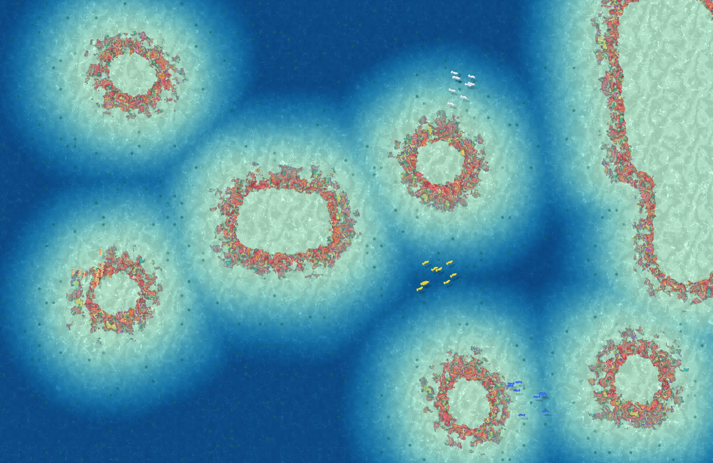
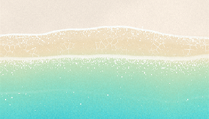
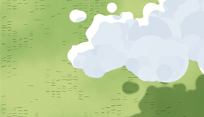
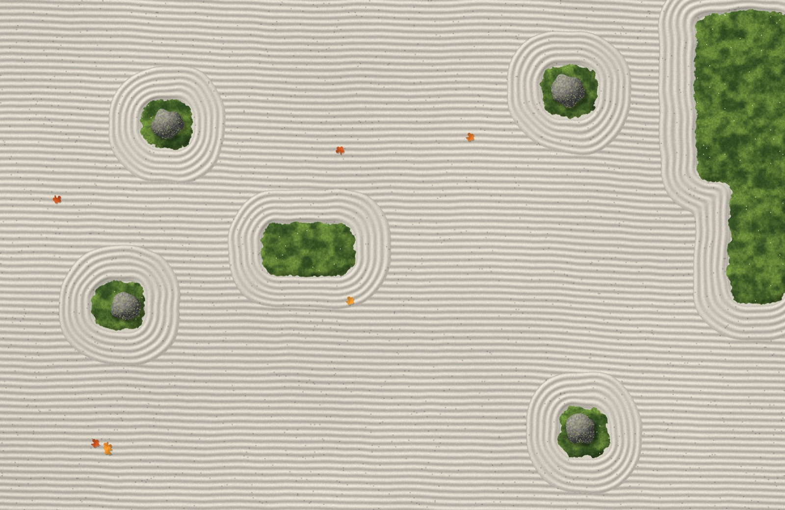
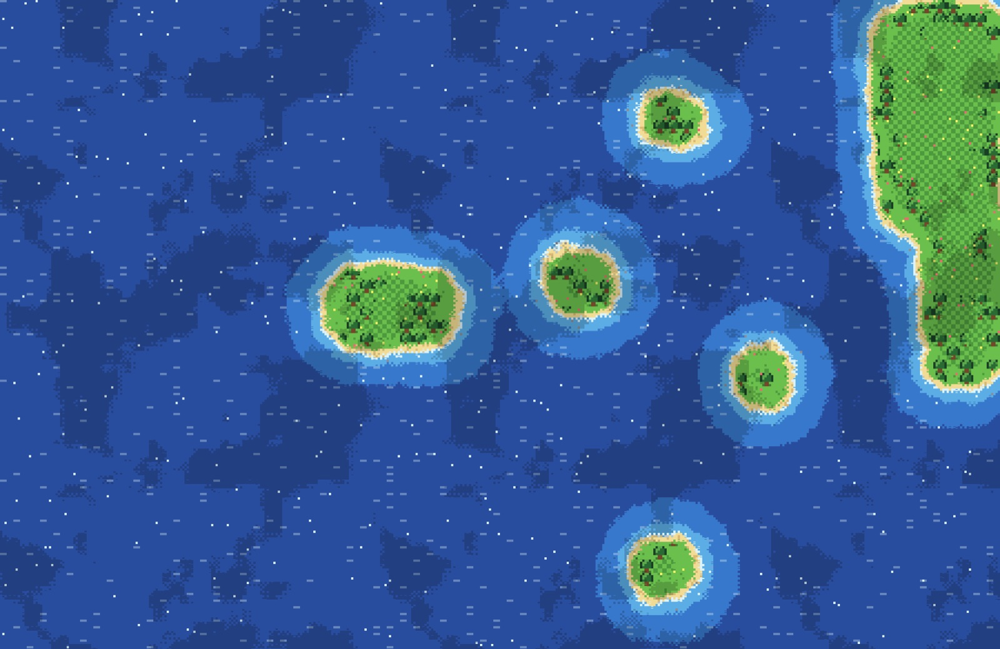
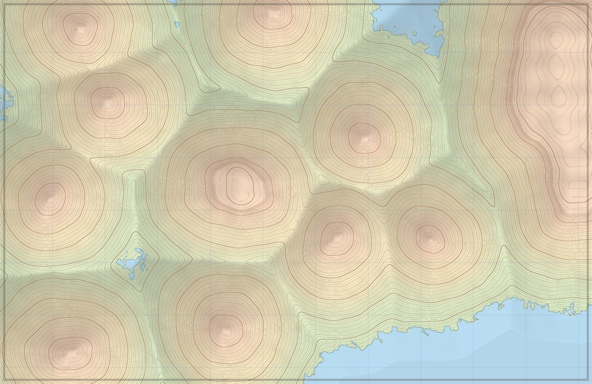
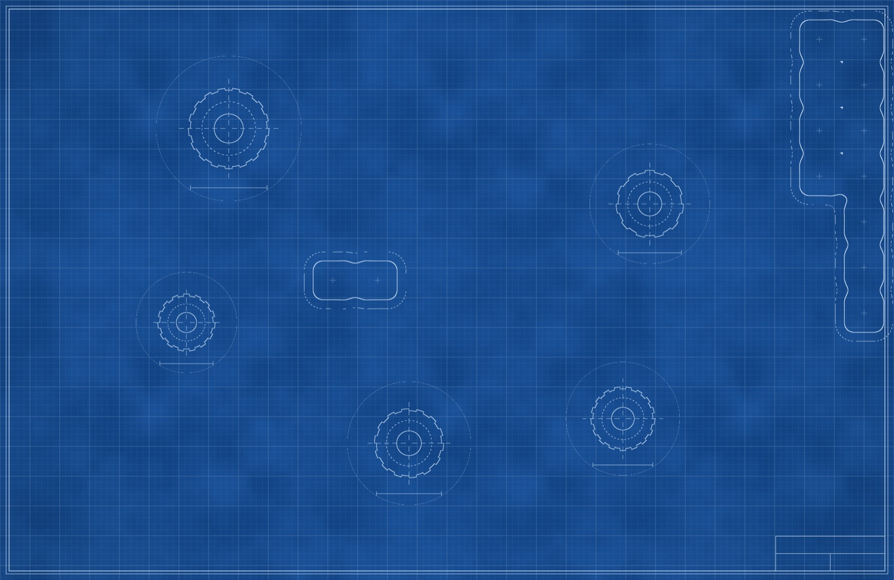

# Lichen

**English** · [Italiano](README.it.md)

<p align="center"></p>

An animated wallpaper for macOS that grows a landscape around your desktop icons.
Move, create or delete a file on the desktop and the landscape reshapes itself. Every launch
(or "New landscape" from the menu) generates different coasts, dunes and furrows.

Free software under the **GPL-3.0**. Free of charge, no ads, no account.
If you like it, you can [support the project](https://namecoder1.github.io/lichen/#support) with a voluntary donation.

> Lichen is an independent macOS project inspired by [Deskland](https://deskland.app) (Windows).
> The Beach and Meadow themes come from [Deskland Preview](https://github.com/BLEZZ0102/Deskland) (GPL-3.0).
> Lichen is not affiliated with or endorsed by Deskland. See [NOTICE](NOTICE).

> **Note:** the interface is currently in Italian. An English localization is planned.

## Install

```sh
brew install --cask namecoder1/tap/lichen
```

or download the zip from [Releases](https://github.com/namecoder1/lichen/releases), unzip it and move
`Lichen.app` to Applications. Requires macOS 13 or later, Apple Silicon or Intel.

On first launch macOS asks for **Accessibility** access: Lichen uses it only to read *where* the
icons are on the desktop.

## Themes

| | |
|---|---|
| <br>**Beach** (Deskland): turquoise coasts, kayaks, palms and gulls | <br>**Meadow** (Deskland): clouds, a kite and a kitten |
| <br>**Zen garden**: moss islands, raked gravel, rocks and maple leaves. Static | <br>**Coral reef**: sandbanks, coral colonies, caustics and fish |
| <br>**Pixel RPG**: a 16-bit map with trees, flowers and pixel waves | <br>**Topographic**: contour lines, hypsometric tints and lakes. Static |
| <br>**Blueprint**: drafting paper with dimensioned outlines. Static | |

## Features

- **Menu bar panel** in Control Center style (Liquid Glass on macOS 26+).
- **Per-theme settings:** sliders and toggles (island size, palms, kayaks, clouds, zen rings…).
- **Ripples:** clicking the desktop sends a wave where there is water (or a pencil mark on maps).
- **Daylight:** golden hour, blue hour and night following the sun (estimated from the time zone,
  no location access) or the macOS dark appearance.
- **Theme rotation:** hourly, daily or at every launch.
- **One theme per display** on multi-monitor setups.
- **Lock screen:** the theme (without icons) becomes the system wallpaper, or the animated screen saver
  starts when you lock the Mac.
- **Animated screen saver** (`Lichen.saver`) with the same engine.
- **Automatic updates** with [Sparkle](https://sparkle-project.org).
- **Light on resources:** static themes use no GPU at rest. Animated themes pause when windows cover
  the desktop, slow down when it is barely visible or nobody is using the Mac, and render at lower
  resolution on battery, in Low Power Mode, on Intel Macs or when the Mac runs hot.
  See the [benchmarks](docs/benchmarks/README.md).

## Privacy

- **Accessibility** is used only to read the positions of desktop icons, never file names or contents.
- The only network connection is the update check (Sparkle, once a day, to GitHub).
  No analytics, no account.
- Desktop clicks are observed only to draw ripples (can be turned off).

## How it works

- **Host (Swift):** one window per display at desktop level (below the icons, ignoring clicks) hosting a
  `WKWebView`. It reads icon positions from Finder through the Accessibility API and pauses the theme
  when nobody can see it.
- **Themes (HTML + WebGL2):** each theme is a page in `Resources/themes` speaking Deskland's protocol:
  the page sends `ready`, the host sends `icons` (rectangles in device pixels), `settings` and `pause`.
  For Deskland pages the host emulates `window.chrome.webview` (WebView2).
- **Field:** for every point, the signed distance from the "coast" around the icons (a sum of Gaussians
  warped by seeded noise) is computed on the CPU and handed to the shader.

| Path | Role |
|---|---|
| `Sources/Lichen/AppDelegate.swift` | Main loop: windows per display, icons, pausing, quality, panel actions |
| `Sources/Lichen/IconReader.swift` | Icon positions from Finder (Accessibility API) |
| `Sources/Lichen/DesktopWindow.swift` | Desktop-level window hosting a theme |
| `Sources/Lichen/PanelView.swift`, `PanelWindow.swift` | Menu bar panel (SwiftUI) and its window |
| `Sources/Lichen/Shared/` | Code shared with the screen saver: theme catalog, web view, settings, quality |
| `Saver/LichenSaverView.swift` | `Lichen.saver` screen saver |
| `Resources/themes/lichen/core.js` | Shared engine of Lichen themes (field, noise, morphing, protocol) |
| `Resources/themes/lichen/*.html` | Lichen themes: a shader plus detail placement each |
| `Resources/themes/deskland/` | Deskland themes, unmodified (commit in `UPSTREAM_COMMIT`) |
| `Resources/themes/patches/` | Lichen's fixes to Deskland themes, applied by the host |

To make a theme, copy `zen.html`, change the shader (`fieldS(p) < 0` under the icons) and add it to
`ThemeCatalog.all`. Opening the page directly in a browser shows a preview with fake icons.

## Development

```sh
swift build -c release && .build/release/Lichen   # quick run (grant Accessibility to the terminal)
.build/release/Lichen --snapshot /tmp/out zen      # PNG of themes with your icons (--demo: fake icons)
.build/release/Lichen --thumbs Resources/thumbs    # regenerate theme thumbnails
.build/release/Lichen --panel-test                 # measure panel smoothness
.build/release/Lichen --attention                  # visible desktop share and idle time
scripts/bench.sh                                   # GPU benchmark of every theme
scripts/build-app.sh 0.1.0                         # dist/Lichen.app + zip
```

Releases: pushing a `vX.Y.Z` tag runs `.github/workflows/release.yml`, which builds, signs, notarizes,
publishes the GitHub Release with a Sparkle `appcast.xml` and updates the Homebrew tap. Tags with a
hyphen (`v1.0.0-rc.1`) become pre-releases. Release checklist and credentials: [docs/MAINTAINING.md](docs/MAINTAINING.md).

## Support Lichen

Lichen is free and will stay free. If it keeps you company on your desktop and you'd like to help:
[GitHub Sponsors](https://github.com/sponsors/namecoder1) (monthly or one-time) or
[Ko-fi](https://ko-fi.com/namecoder1) (no account needed, card or PayPal). A star or a bug report helps too.

## License

[GPL-3.0-or-later](LICENSE). Credits and trademarks in [NOTICE](NOTICE). Changes in [CHANGELOG](CHANGELOG.md).
